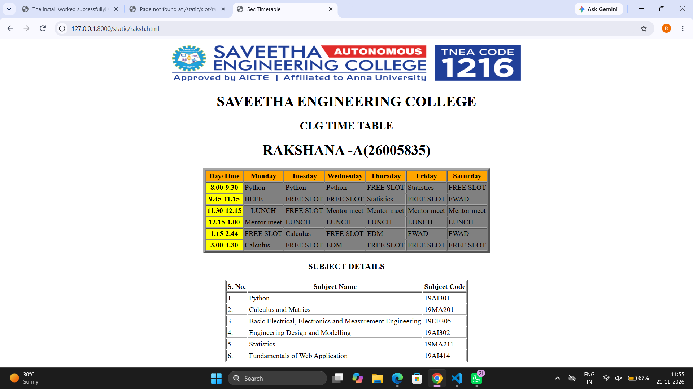

# Ex04 Time Table
## Date:21-11-26

## AIM
To write a html webpage page to display your slot timetable.

## ALGORITHM
### STEP 1
Create a Django-admin Interface.

### STEP 2
Create an App inside the Django project.

### STEP 2
Create a static folder uder the created App and insert HTML code.

### STEP 3
Create a simple table using ```<table>``` tag in html with the relevant attributes.

### STEP 4
Add rows using ```<tr>``` tag.

### STEP 5
Add your course schedule using ```<td>``` tag.

### STEP 6
Execute the program using runserver command.

## PROGRAM
```
<html>
    <head>
        <title>Sec Timetable</title>
    </head>
    <body>
        
<center>
     <image src="logo.png" height="90" width="800";margin: auto;magin-left:auto;></image>
    <h1>SAVEETHA ENGINEERING COLLEGE</h1>


    <h2>CLG TIME TABLE</h2> 
    <h1>RAKSHANA -A(26005835)</h1>

    <table border="4" cellpadding="2" cellspacing="2" bgcolor="grey">

<tr bgcolor="orange">
    <th>Day/Time</th>
    <th>Monday</th>
    <th>Tuesday</th>
    <th>Wednesday</th>
    <th>Thursday</th>
    <th>Friday</th>
    <th>Saturday</th>
</tr>

<tr>
    <th bgcolor="yellow">8.00-9.30</th>
    <td>Python</td>
    <td>Python</td>
    <td>Python</td>
    <td>FREE SLOT</td>
    <td>Statistics</td>
    <td>FREE SLOT</td>
</tr>

<tr>
    <th bgcolor="yellow">9.45-11.15</th>
    <td>BEEE</td>
    <td>FREE SLOT</td>
    <td>FREE SLOT</td>
    <td>Statistics</td>
    <td>FREE SLOT</td>
    <td>FWAD</td>
</tr>

<tr>
    <th bgcolor="yellow">11.30-12.15</th>
    <td align="center">LUNCH</td>
    <td>FREE SLOT</td>
    <td>Mentor meet</td>
    <td>Mentor meet</td>
    <td>Mentor meet</td>
    <td>Mentor meet</td>
</tr>

<tr>
    <th bgcolor="yellow">12.15-1.00</th>
    <td>Mentor meet</td>
    <td>LUNCH</td>
    <td>LUNCH</td>
    <td>LUNCH</td>
    <td>LUNCH</td>
    <td>LUNCH</td>
</tr>

<tr>
    <th bgcolor="yellow">1.15-2.44</th>
    <td>FREE SLOT</td>
    <td>Calculus</td>
    <td>FREE SLOT</td>
    <td>EDM</td>
    <td>FWAD</td>
    <td>FWAD</td>
</tr>

<tr>
    <th bgcolor="yellow">3.00-4.30</th>
    <td>Calculus</td>
    <td>FREE SLOT</td>
    <td>EDM</td>
    <td>FREE SLOT</td>
    <td>FREE SLOT</td>
    <td>FREE SLOT</td>
</tr>

</table>

<h3>SUBJECT DETAILS</h3>

<table border="2" cellpadding="2" cellspacing="2" bgcolor="white">

<tr>
    <th>S. No.</th>
    <th>Subject Name</th>
    <th>Subject Code</th>
</tr>

<tr>
    <td>1.</td>
    <td>Python</td>
    <td>19AI301</td>
</tr>

<tr>
    <td>2.</td>
    <td>Calculus and Matrics</td>
    <td>19MA201</td>
</tr>

<tr>
    <td>3.</td>
    <td>Basic Electrical, Electronics and Measurement Engineering</td>
    <td>19EE305</td>
</tr>

<tr>
    <td>4.</td>
    <td>Engineering Design and Modelling</td>
    <td>19AI302</td>
</tr>

<tr>
    <td>5.</td>
    <td>Statistics</td>
    <td>19MA211</td>
</tr>

<tr>
    <td>6.</td>
    <td>Fundamentals of Web Application</td>
    <td>19AI414</td>
</tr>

</table>

</center>

</body>
</html>
```

## OUTPUT

## RESULT
The program for creating slot timetable using basic HTML tags is executed successfully.
